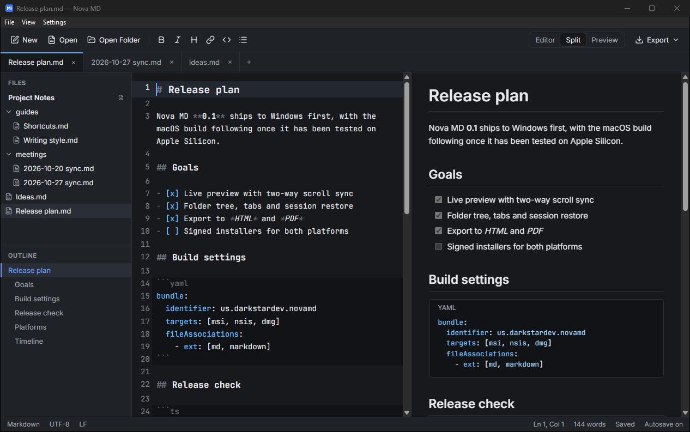
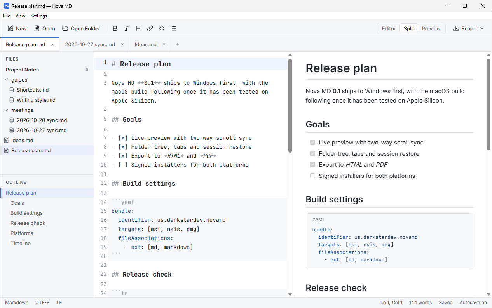
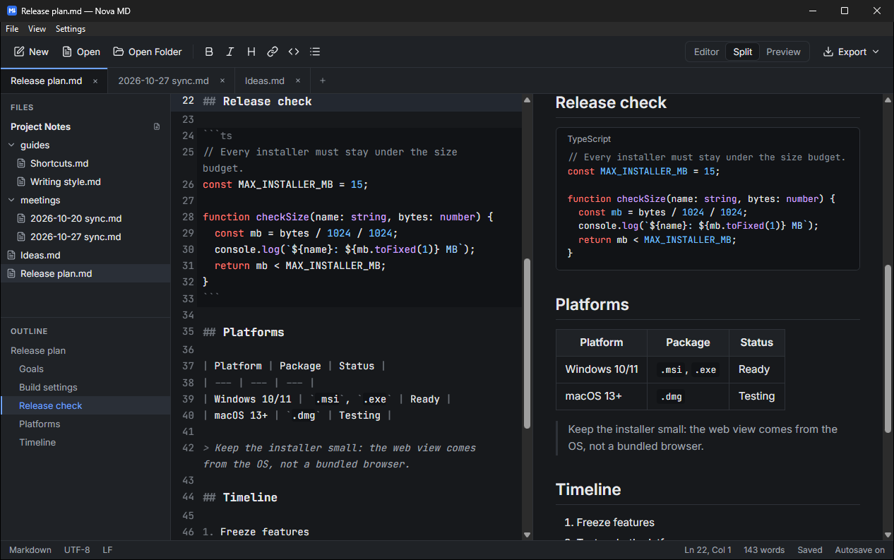

# Nova MD

A desktop Markdown editor for Windows and macOS (Apple Silicon), built with Tauri 2, React + TypeScript and CodeMirror 6. See [BRIEF.md](BRIEF.md) for the full spec and build order.



**[Download for Windows](https://github.com/jgruber96/nova-md/releases/latest)** (installer under 5 MB). The macOS build is still to come.

## Features

- **Live preview** beside the editor, updated as you type, with scroll kept in sync both ways
- **Folder workspace**: a tree of every Markdown file with new, rename and delete, which follows changes made outside the app
- **Tabs** with an unsaved dot, a save prompt on close, and session restore on the next launch
- **Outline** of the current file's headings; click one to jump both panes there
- **Syntax highlighting** for Markdown and for code in 12 languages, with the same colors in the editor and the preview
- **Formatting** buttons and shortcuts, plus autosave after 2 seconds idle
- **Export** to a standalone HTML file or to PDF
- **Light and dark** themes that follow the OS, with an override and six accent colors

## Screenshots

| Light | Code and tables |
| --- | --- |
|  |  |

## Prerequisites

- Node.js 20+ and npm
- Rust (stable, via rustup)
- Windows: Visual Studio 2022 Build Tools with the "Desktop development with C++" workload, and the WebView2 runtime (preinstalled on Windows 11)
- macOS: Xcode Command Line Tools (`xcode-select --install`)

## Run

```bash
npm install
npm run tauri dev
```

## Build installers

```bash
npm run tauri build
```

Each platform builds its own installers: on Windows, an `.msi` and an NSIS `.exe` under `src-tauri/target/release/bundle/`; on macOS, a `.dmg` for Apple Silicon:

```bash
npm run tauri build -- --target aarch64-apple-darwin
```

Builds are unsigned, so Windows SmartScreen and macOS Gatekeeper warn on first launch. Both register `.md` and `.markdown` files to open in Nova MD.

## Keyboard shortcuts

Ctrl on Windows, Cmd on macOS.

| Action | Shortcut |
| --- | --- |
| New / Open / Open Folder | Ctrl+N / Ctrl+O / Ctrl+Shift+O |
| Save / Save As | Ctrl+S / Ctrl+Shift+S |
| Close tab / next tab / previous tab | Ctrl+W / Ctrl+Tab / Ctrl+Shift+Tab |
| Export as HTML / PDF | Ctrl+Shift+E / Ctrl+P |
| Editor only / Split / Preview only | Ctrl+1 / Ctrl+2 / Ctrl+3 |
| Bold / Italic / Link | Ctrl+B / Ctrl+I / Ctrl+K |
| Move focus out of the editor | Esc, then Tab |
| Back to the editor from the sidebar | Esc |
| File tree | Arrows to move and open or close folders, Enter to open, F2 to rename, Delete to delete |

## macOS test checklist

Not yet run on a Mac. On macOS 13+ (Apple Silicon), check:

- [ ] The app menu holds Settings (Theme, Accent Color, Autosave) and Quit; Cmd+C/V/X/Z work in the editor
- [ ] Open Folder, tree new/rename/delete (to the Trash), and outside edits appearing without a restart
- [ ] Closing an unsaved tab and quitting with Cmd+Q both ask to save
- [ ] Export as PDF opens the print dialog; its PDF button saves a light-themed copy of the preview
- [ ] Export as HTML opens in Safari looking like the preview
- [ ] Double-clicking a `.md` file in Finder opens it, both when Nova MD is closed and when it is running

## Status

- [x] 1. Shell and editor: five-band layout, theme tokens, single-file open/save
- [x] 2. Live preview: markdown-it + DOMPurify, view modes, two-way scroll sync
- [x] 3. Highlighting: Markdown styles and fenced-code packs in the editor, Shiki in the preview
- [x] 4. Workspace and tabs: folder tree with new/rename/delete, folder watcher, multiple tabs, session and window-size restore
- [x] 5. Outline, toolbar and status bar: outline with jump and in-view highlight, formatting buttons and Ctrl/Cmd+B/I/K, autosave setting, status bar
- [x] 6. Export and polish: HTML and PDF export, theme and accent settings, View menu, keyboard pass, file associations (tested on Windows; macOS checklist above)

## License

[MIT](LICENSE) © DarkstarDEV. The bundled Inter and JetBrains Mono fonts are under the SIL Open Font License.
